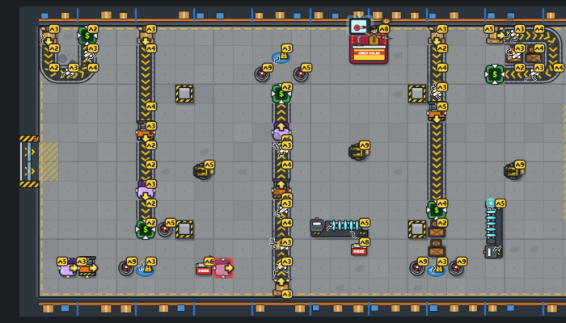
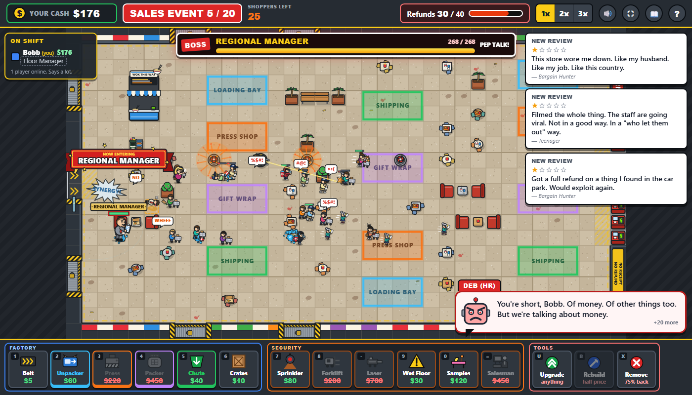
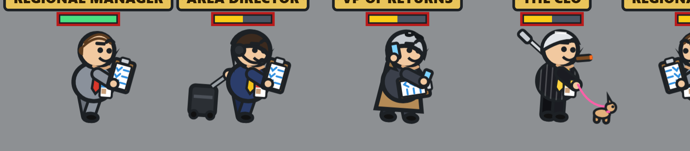
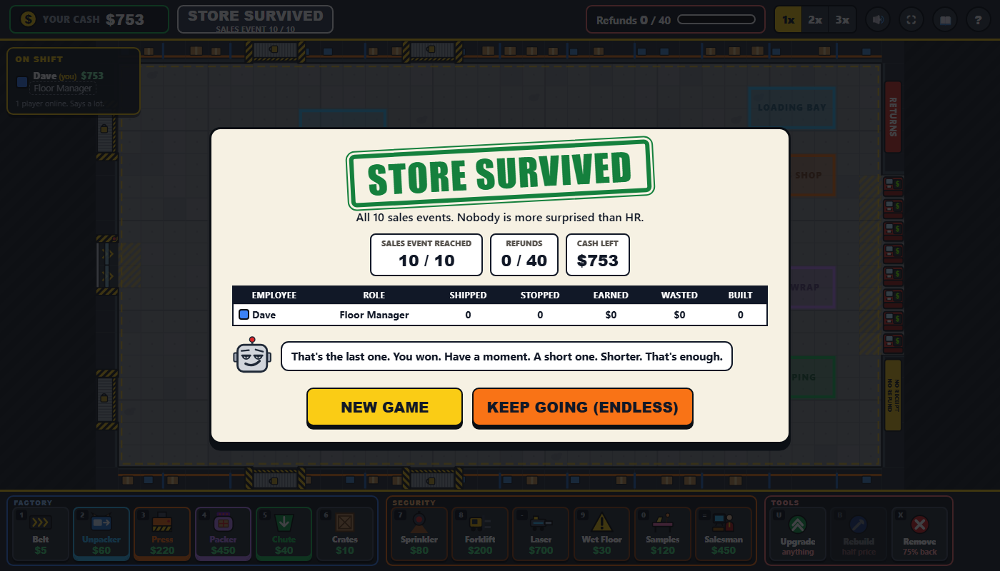
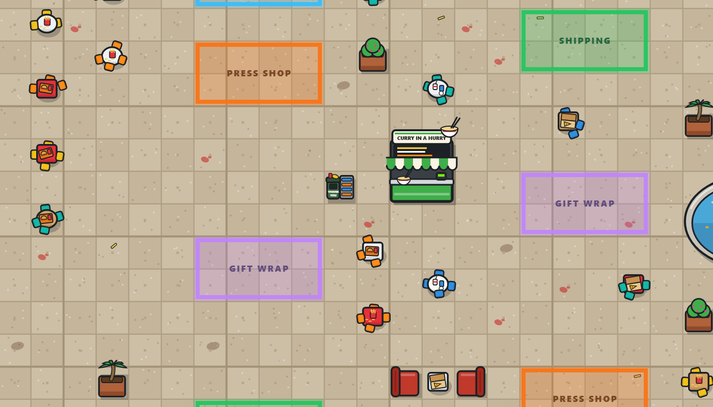
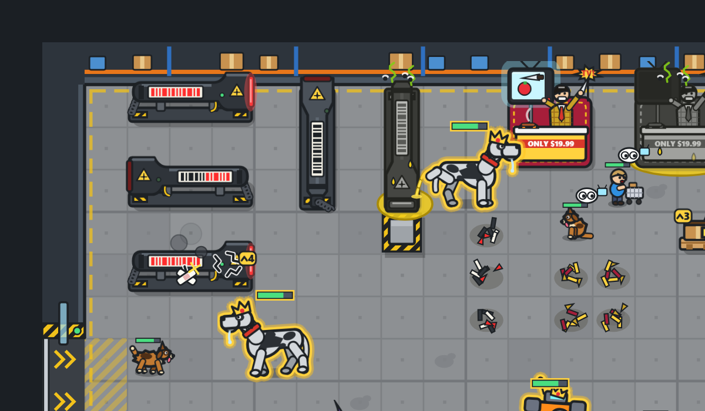

# Release 0.2.06: a boss every fifth event, endless mode, the Food Court, flow arrows, the Barcode Laser

Date: 2026-11-16. Committed and pushed to `main`; the menu will read **0.2.06**.

## Needs your attention

1. **I made the design decisions myself, because you were away.** The three that are most a matter of taste are the new name (Barcode Laser), how tough the boss is, and what he does. They are listed under "Decisions made for you" and two of them are the questions at the end. All are quick to change.
2. **The boss is not much tougher than a Karen the first time he comes.** I first gave him far more patience, but security always shoots whoever is nearest the tills, so a slow man at the back of the crowd was shot last and walked through every time. At his current patience the scripted test players just manage to drive him out in event 5. He gets much tougher each visit, and what makes him dangerous is the pep talk and the five refunds if he gets through. Whether he feels like a boss needs a person's opinion.
3. **Nobody has played or heard any of this.** 226 automated tests pass and I checked each screen with scripted input, but no person has played a boss event, an endless game or the Food Court, and the new sounds are measured, not listened to.
4. **Some jokes live in the drawing code,** not in the dialogue file: the food stall names (for example "BIG DICK'S DOGS", "TACO BELLEND", "PHO KING GOOD"), the boss's pep-talk buzzwords and his parting words. They are in `src/render/floor.js` and `src/render/effects.js` if you want to change them.
5. **Most of this work was done by Opus workers,** as you asked; I planned it, checked their output and fixed what did not fit together.

## Outline

### 1. The Rail Gun is now the Barcode Laser
A supermarket barcode scanner turned up far too high: it fires a red beam through everyone in the queue, with a loud checkout "BEEP". Nothing about how it works changed. The button in the build bar reads "Laser". It is redrawn as a scanner whose barcode fills in red as it charges, with proper drawings facing up and down (one of the weaknesses you asked me to fix). DEB's jokes about it were rewritten to fit.

### 2. Arrows on every factory building
Unpackers, Presses and Packers carry a big yellow arrow on the side the goods come out of; the Press and Packer also have small white arrows on the sides that take goods in. The Shipping Chute has four white arrows pointing in. Yellow means out, white means in. The placement preview shows the arrow before you build, and belt chevrons are fatter when zoomed out.

### 3. A boss every fifth sales event
- One boss walks in 12 seconds after the doors open on events 5, 10, 15 and so on. His title climbs each time: **Regional Manager, Area Director, Vice President of Returns, The CEO** (and the CEO keeps coming in an endless game). Each is drawn differently and bigger than any other shopper, with a name plate.
- **Nothing slows or stops him:** not wet floors, samples, the TV Salesman or the exhibitionist.
- **Pep talk:** every 7 seconds every shopper within 3.5 tiles of him gets 20% of his patience back.
- **If he reaches a till** he counts as **five refunds** and takes $150 times his rank.
- **If you wear him out** the store is paid a bounty of $150 times his rank (more or less with the difficulty).
- **The rest of that event's crowd is 75% of its usual size,** as you asked.
- A bar across the top of the floor shows his title and patience while he is in the store, and warns you during the build phase before his event. The top bar's heading says "BOSS EVENT NEXT" too.
- DEB announces each title with its own jokes; the handbook and README have a boss entry with all his numbers.
- Head Office cannot buy him and he comes whatever Head Office planned.

### 4. Endless mode
- A fifth choice for the length of a game: **Endless**. There is no last event; the game ends only when the refund limit is reached.
- After winning a normal game, the win screen has a second button, **Keep going (endless)**. In multiplayer anyone in the store can press it.
- The best event you reach is remembered in your browser, per difficulty, and shown on the lost screen and the menu.
- From about event 30 the crowd stops growing (about 1,100 shoppers per player in one event) and only patience keeps growing. Without that limit event 60 would have sent 3,900 shoppers at a solo player and event 100 over 10,000.

### 5. The Food Court
A fourth store design: little tables in staggered clusters, booths, benches with planters, bins, food stalls and, from the two-player size up, a fountain. All of it is solid, so shoppers weave through it and your belts have to go round it.
- Nothing can be sealed off, on any of the eight sizes.
- The automatic checker fits every production line it tries on every size (the Showroom manages 12 of 18 on the biggest).
- The walk to the tills is at most about 10% longer than on the Open Warehouse.

### 6. The small drawing weaknesses
- The Great Dane is redrawn and reads as a huge dog.
- The Stray Dog is slightly bigger, ginger with a dark saddle, and visible when zoomed out.
- The laser has its own drawings facing up and down.
- A mom's abandoned cart is now part of the game itself, so a player who joins mid-event sees it.

## Decisions made for you

| Decision | What I chose | Why |
|---|---|---|
| New name | Barcode Laser | It fires a beam through a queue, like a scanner; it fits a store and gives DEB "unexpected item in the bagging area" jokes |
| Boss mechanics | Unstoppable, pep talk, five refunds, a bounty | He has to matter without needing the players to aim, since security picks its own targets |
| Boss patience | 4 Bargain Hunters' worth, half as much again each visit | Tuned so the scripted players just beat him in event 5; see "Needs your attention" 2 |
| Endless | A length setting, plus "Keep going" after a win | Covers both starting endless and not wanting a good game to end |
| Crowd limit in endless | About 1,100 shoppers per player per event | Keeps the game running; patience still grows without limit |
| Food stall names | Crude puns | In keeping with the game's tone |

## Test results
- `node --test`: **226 of 226 pass** (38 new, covering the boss, endless mode, the Food Court, the interface and DEB's new lines).
- Scripted players on Normal (the event each of three loses in), before and after the boss:

| Seed | Before | After |
|---|---|---|
| 11 | 10 / 14 / 15 | 10 / 15 / 15 |
| 5 | 10 / 15 / 14 | 10 / 15 / 14 |
| 23 | 10 / 15 / 14 | 11 / 15 / 15 |

- Production lines on the Food Court: every line fits on all eight sizes.
- In a browser with scripted input, no page errors: a real game on the Food Court played to the first boss; two players; the touch checks at phone size (34 of 34); both halves of the training shift to "Training complete".
- Sound measuring page: ALL PASS, with the boss's voice included.

## What changed (files)
- Rules: `src/sim/` (`constants.js` has `BOSS` and the new numbers; `step.js`, `commands.js`, `maps.js`, `state.js`).
- Drawing: `src/render/` (every file), `src/ui/portrait.js`.
- Interface: `src/ui/bossbar.js` and `src/ui/record.js` (new), and the top bar, menu, settings, end screens, handbook, planner and save code.
- Dialogue: `src/content/lines.js`, `src/content/director.js`.
- Sound: `src/audio/boss.js` (new) and the rest of `src/audio/`.
- Tests: `test/boss.test.js`, `test/endless.test.js`, `test/foodcourt.test.js`, `test/interface-boss-endless.test.js` (new).
- Documents: `README.md` (new pictures in `docs/img/`), `PLAN.md` ("Version 0.2.06"), `docs/architecture.md`.

## How to verify
1. Open https://bobbfwed.github.io/No-Receipt-No-Mercy/ and check the menu says 0.2.06.
2. Pick the Food Court and Endless on the menu and play solo. The fifth event brings the Regional Manager.
3. Build an Unpacker and turn it with R: the yellow arrow shows where the boxes come out.
4. To see everything without playing: `node tools/serve.mjs`, then http://localhost:5173/tools/render-harness.html?showcase=1 and http://localhost:5173/tools/render-harness.html?lineup=1 .

## Suggested next steps
1. Play to event 5 and say whether the boss is tough enough (question 2 below).
2. Listen to the new sounds: the boss's voice and the laser's beep are the likeliest to need work.
3. The relay server, so two players in one house can connect.
