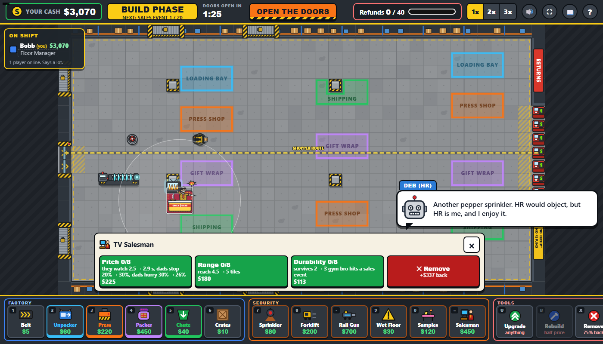
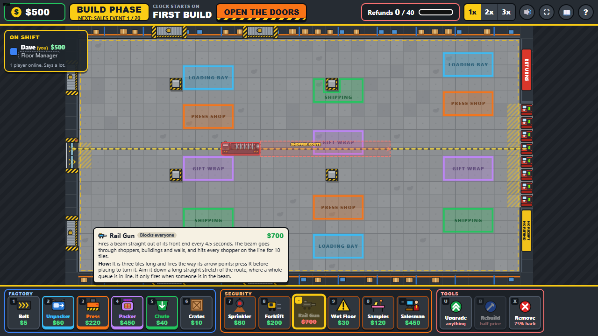
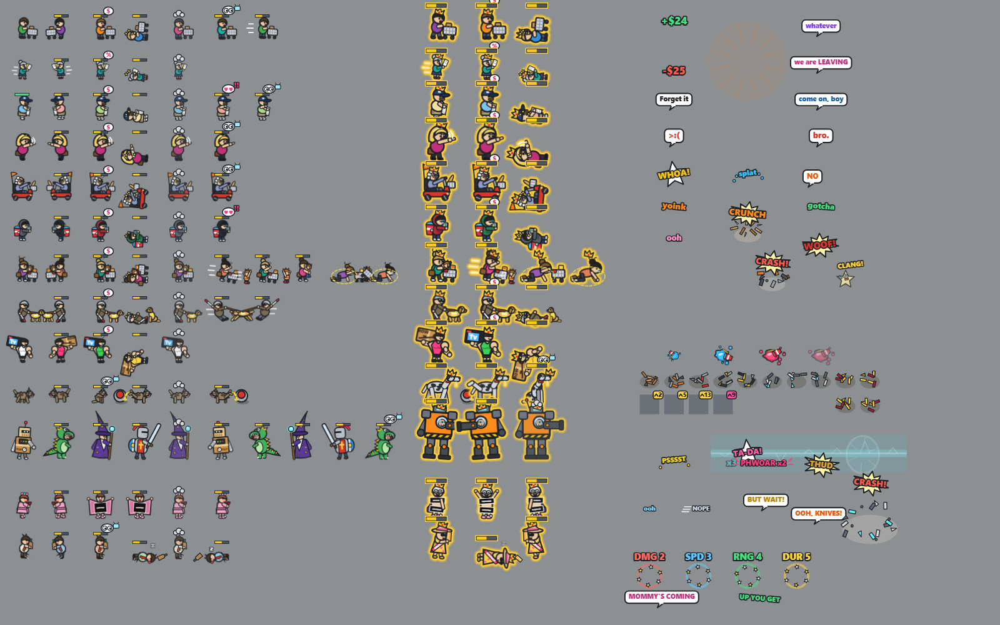
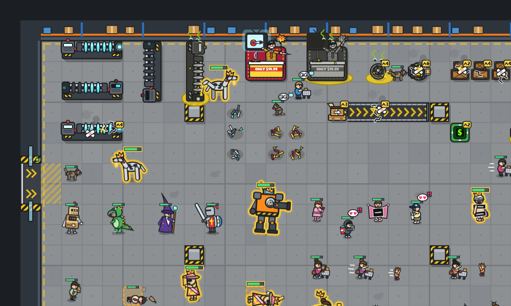

# Version 0.2: split upgrades, two new security buildings, four new shoppers, a quieter DEB

Date: 2026-11-16. Game version after this work: **0.2.01**. Everything is committed and pushed to `main`, so the published site updates by itself.

## Needs your attention

1. **Normal is now a lot easier, by more than the 10% you asked for.** You asked for the split upgrades to be cheaper than the old single upgrade. They are, and the effect is large: a dollar spent on upgrades now buys about twice the damage it did. Together with the 10% easing, my scripted test players, who used to lose at sales event 7 to 9 on Normal, now lose at 14 or 15. You reached 13 before these changes, so you will probably get further now. That is the direction you asked for, but it may have overshot. Play a game before deciding; question 1 at the end is about this.
2. **Nobody has played any of this.** It is covered by 182 automated tests (all passing) and checked on screen with scripted mouse, keyboard and touch input, but no person has played a game with the new buildings or shoppers, and nobody has heard the new sounds.
3. **Saved games from 0.1 will not load.** The shape of a saved game changed (separate upgrade levels, bigger buildings). The menu simply will not offer an old save.
4. **Gym bros behave differently at crate walls, which you did not ask for.** Durability applies to every building, crates included. A gym bro still walks through crate stacks, but a crate stack with durability upgrades now holds him up while he hits it. It follows from the rule you described; question 2 asks whether you want it.
5. **Things I decided for you** (all easy to change):
   - The Rail Gun costs $700, the TV Salesman $450. All the numbers are in the tables below.
   - The Exhibitionist is drawn with a black "CENSORED" bar when the robe opens (question 3).
   - DEB got two announcements you did not ask for: a warning when refunds reach 75% and 90% of the limit, and one send-off line when one of the three named friends leaves.
   - Your "fewer gym bros mid-game" idea is recorded in `PLAN.md` under ideas for later, not built, as you asked.
6. **Still open from before:** two players on the same home network usually cannot connect until the relay server is set up (you said you would do that later). Not tested on an iPhone.

## Outline

### 1. Difficulty: every level is 10% easier
Shopper patience is multiplied by 0.9 and income by 1.1 on every level. Easy is now patience x0.68 / income x1.38, Normal x0.9 / x1.1, Hard x1.17 / x0.94, Brutal x1.49 / x0.77.

### 2. DEB talks less, repeats less, and knows your friends
- **Three times the jokes.** The file of lines went from 344 to 1,377 lines of text. Every bank of lines (wave start, building placed, a shopper escaping, reviews, and so on) has roughly three times as many.
- **Weighted.** Each line is common, uncommon (about a third as likely) or rare (about a tenth as likely).
- **Used lines fade.** Once a line has been said in a game it is 8 times less likely to come up again in that game.
- **Fewer announcements over time.** Each kind of remark gets less likely, and further apart, every time DEB has made it. Things that matter are always said: a wave starting, a new kind of shopper, the refund limit getting close, a player joining or leaving, winning and losing.
- **Bobb, Phantasm and Tusker.** About 35 lines each, built on what you told me about them. They are used only when a player with exactly that name (capitals do not matter) is in the game, as you chose. When a line would name that player, a third of the time it is one of his own; and in about 45% of the breaks between waves DEB has a go at one of them unprompted.
- **Everyone hears the same line with the same name.** DEB runs on the host only and her line is sent to every player, so the whole group hears the same joke about the same person.

### 3. Upgrades are split into Damage, Speed, Range and Durability ⚠️
Click a building (or tap it on a phone) and a sheet opens with a button for each kind of upgrade, showing its level, what the next level changes, and the price. Up to 8 levels each; each level costs 1.6 times the last.

| Building | Damage (or main effect) | Speed | Range | Durability |
|---|---|---|---|---|
| Sprinkler ($80) | x1.25 a level, first level $48 | fires 10% faster, $48 | +0.15 tiles, $32 | +1 hit, $24 |
| Forklift ($200) | x1.3, $120 | 12% faster, $120 | +0.3 tiles, $80 | +1 hit, $60 |
| Rail Gun ($700) | x1.3, $350 | 12% faster, $350 | beam +1 tile, $175 | +1 hit, $140 |
| TV Salesman ($450) | longer stop, better odds, $225 | none | +0.5 tiles, $180 | +1 hit, $113 |
| Wet Floor, Samples | stronger effect | none | Samples only | +1 hit |
| Unpacker, Press, Packer | none | 25% faster a level, 5 levels, first level $400 / $600 / $900, each 1.8 times the last | none | +1 hit |
| Belt, Crate, Chute | none | none | none | +1 hit |

- **Factory upgrades are expensive on purpose**, as you asked. A belt carries 4 items a second, so even a machine at the top level is never held back by its belt.
- **The U key** still works: it buys the next level of the first upgrade (damage, on security) for the building under the mouse.
- ⚠️ See "Needs your attention" 1: the split upgrades are much better value than the old ones.

### 4. Durability and half-price rebuilding
- A gym bro's hit no longer wrecks a building at once or knocks a level off. Each building survives a number of hits per sales event: 1 as built, 2 for a Rail Gun or TV Salesman, and one more per durability level. The count starts again when the event ends. Damage shows as cracks, then bandages, then smoke.
- A wrecked building comes back for **half of everything spent on it, upgrades included**.
- If you press B (rebuild everything) without enough money, each building comes back at half price with as many of its upgrades as you can afford at half price. The rest are lost, and DEB tells you.

### 5. Security: Rail Gun, TV Salesman, longer forklift reach
- **Forklift** reaches 6 tiles (was 5.5).
- **Rail Gun** ($700, 3 x 1, press R to turn it before placing). Every 4.5 seconds it fires a beam 10 tiles long straight out of its front end, through walls, buildings and shoppers, hitting everyone on the line for 60. A forklift fires every 1.6 seconds for 30. The preview shows the strip the beam will cover.
- **TV Salesman** ($450, 2 x 2, reaches 4.5 tiles). A man in a mustard suit demonstrating knives and barbecues, with a television on a pole. Each shopper who comes within reach either stops to watch for 2.5 seconds, hurries past 40% faster for 4 seconds, or ignores him.

| Shopper | Stops | Hurries |
|---|---|---|
| Dad | 20% | 30% |
| Mobility Scooter | 80% | 0% |
| Karen | 40% | 0% |
| Bargain Hunter | 35% | 10% |
| Teenager | 5% | 25% |
| Stray Dog | 10% | 50% |
| Runaway child | 70% (watches the television) | - |

  Pitch upgrades lengthen the stop and move the odds your way (a dad: 20% stop / 30% hurry becomes 30% / 26% after one level).

### 6. Shoppers
- **Moms.** The child runs away once (twice for a Soccer Mom), 20% further than before, never closer than two tiles of walking from a till, and always to somewhere she can reach. She will not take a refund without him. A mom who has gone down crawls faster than before (70% of walking speed, was 55%), in a proper hands-and-knees pose, and when she gets up she has lost her cart and carries the child, which shows he has had his run. The Soccer Mom keeps her cart until the second time she goes down.
- **Day Drinker** (from sales event 5). Walks at a speed that keeps changing, and may fall over at corners of the route. While he lies there for 4 seconds, everyone else crossing that tile moves at about a third of their speed.
- **Stray Dog** (from 7). Fast and weak. Pees on security it passes (not wet floor signs), switching it off for 6 seconds.
- **Exhibitionist** (from 8). A woman in a bathrobe who opens it every 6 seconds or so. Dads and teenagers within 2.5 tiles stop and stare for 2 seconds. She helps you.
- **Cosplayer** (from 9). Patience 150 (a Karen has 170), walking speed 1.25, which no other shopper has. Shots from sprinklers, forklifts and rail guns aimed at anyone touching him hit him instead. Four costumes: cardboard robot, dinosaur onesie, wizard, foam knight.
- Each has a super version: Bottomless Bruncher (from 12), Great Dane (13), Nudist Nan (14), Full Mech Suit (15).

### 7. Other
- Marked floor (Loading Bay and the rest) no longer touches a wall: one tile clear, two in front of a shopper entrance.
- Entrances no longer show a player's name.
- The handbook in the game and the README list the new buildings and shoppers with their numbers and pictures.
- The tutorial, the help screen and the touch wording describe the new upgrades.

### 8. Problems found and fixed along the way
- With fifteen buttons in the build bar, the description card for the tool you are holding was squeezed into a sliver and made the bar taller than the floor. It now floats just above the bar on all but very wide screens.
- The Head Office screen's shopper cards overlapped with thirteen kinds of shopper. They are now seven across.
- DEB's speech bubble was hidden behind the upgrade sheet. It now sits above it.
- The tall Cosplayer was cut off in the handbook pictures.

## Test results
- `node --test`: **182 tests, 182 pass, 0 fail.** 45 are new (30 for the 0.2 rules, 15 for how DEB chooses lines).
- `node tools/balance.mjs` (Normal, one-player map; the sales event each of three scripted players loses in, of 20):

| Seed | Before 0.2 | After 0.2 |
|---|---|---|
| 11 | 7 / 7 / 7 | 10 / 14 / 15 |
| 5 | 9 / 9 / 9 | 10 / 15 / 14 |
| 23 | 9 / 9 / 9 | 10 / 15 / 14 |

- `node tools/line-check.mjs` (do two production lines fit in each section of marked floor): unchanged by moving the floor off the walls. Warehouse and Aisles fit everything; the Showroom is the tight one, as before (the largest size fits 12 of 18).
- In a browser, with scripted input, no page errors: a solo game with the new buildings and the upgrade sheet; a game run through 8 sales events with every new kind of shopper on the floor; two players side by side; the Head Office screen; the handbook; touch checks at phone size (34 of 34); both halves of the training shift played to "Training complete".
- `tools/sound-test.html`: ALL PASS (every new sound is audible, does not clip, and the thirteen shoppers do not sound alike). Measured, not listened to.

## What changed (files)
- Rules: `src/sim/` (`constants.js` has every number; `upgrades.js`, `commands.js`, `step.js`, `state.js`, `path.js`, `maps.js`).
- Jokes: `src/content/lines.js` (all lines, with the rules for adding more at the top), `src/content/director.js` (how often DEB speaks; the numbers are in `TALK` at the top).
- Drawing: `src/render/` (buildings, shoppers, effects).
- Sound: `src/audio/`, new file `src/audio/newfx.js`.
- Interface: `src/ui/touch.js` (the upgrade sheet), `src/ui/upgradetext.js` (new: the wording of each upgrade), `src/ui/buildbar.js`, `src/ui/input.js`, `src/ui/handbook.js`, `src/ui/planner.js`, `src/ui/overlays.js`, `src/style.css`.
- Help and tutorial: `src/content/help.js`, `src/content/touch.js`, `src/tutorial/lessons.js`.
- Tests: `test/v02.test.js` and `test/director.test.js` (new), others updated.
- Documents: `README.md` (with four new shopper pictures in `docs/img/`), `PLAN.md` (a "Version 0.2" section with every decision), `docs/architecture.md`, `CLAUDE.md` (one line).
- Version: `src/version.js` is now 0.2, release 1.

## How to verify
1. Open https://bobbfwed.github.io/No-Receipt-No-Mercy/ and check the menu says **0.2.01** (give GitHub a minute or two after the push).
2. Play solo. Build a Sprinkler, click it, and buy one level of each upgrade. Build a Rail Gun (key `-`, turn it with R) and a TV Salesman (key `=`).
3. Name yourself Bobb and listen to DEB between waves.
4. To see everything at once without playing: run `node tools/serve.mjs` and open http://localhost:5173/tools/render-harness.html?showcase=1 (new buildings and shoppers) and http://localhost:5173/tools/render-harness.html?lineup=1 (every shopper in every state).
5. Open the Employee Handbook (the book button) for the numbers.

## Suggested next steps
1. Play one game on Normal and say whether it is now too easy (question 1).
2. Listen to the new sounds; the animal and voice sounds are the ones most likely to sound robotic.
3. Set up the relay server so two players in one house can join each other.
4. Smaller drawing weaknesses to fix when wanted: the Great Dane looks a little like a giraffe, the Rail Gun facing up or down is the sideways drawing turned, and the Stray Dog is small when zoomed out.
