# No Receipt, No Mercy

*The customer is always a prick.*

<!-- gen:version -->
**Play version 0.2.14 now: https://bobbfwed.github.io/No-Receipt-No-Mercy/** (nothing to install; works in a browser on a computer, a tablet or a phone).
<!-- /gen:version -->

A co-op browser game for 1 to 7 players, set in the returns department of a discount warehouse. Shoppers pour into a discount warehouse wanting refunds. You and your friends each have your own cash (the store's income and refunds are split evenly between you), build a factory of belts and machines to earn more, and build security to make the shoppers give up before they reach the tills. The belts and machines are the maze they walk through. An HR chatbot called DEB insults you the whole time. Adults only.

## The stores
<!-- gen:maps -->
The host picks a design and a size before the game starts. Each player gets his own shopper entrance, and the painted floor shows where each kind of machine may go.

### Open Warehouse
One big empty floor with a few pillars. Every wall in the maze is one you built.

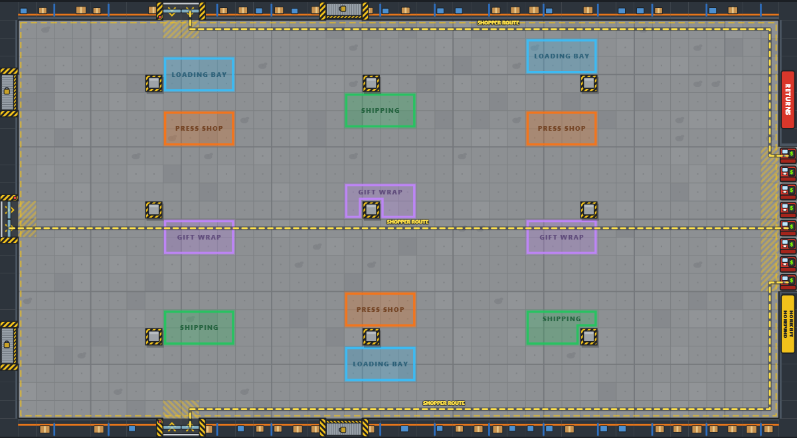

### Flat-Pack Showroom
Walled rooms joined by doorways that everyone, and every belt, has to go through. Good choke points, awkward factories.

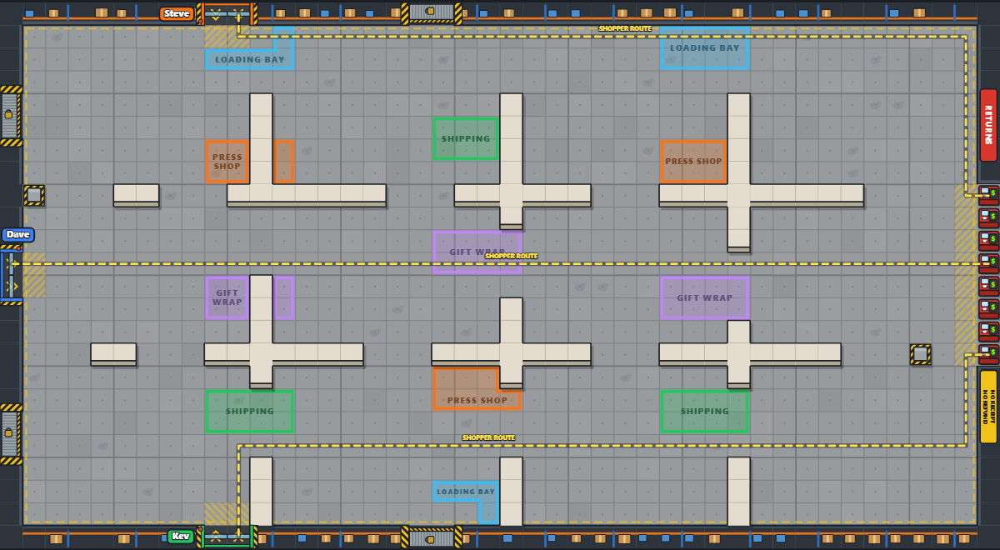

### Supermarket Aisles
Rows of shelving with a wide main aisle down the middle. The shelves are free walls; the main aisle is your problem.

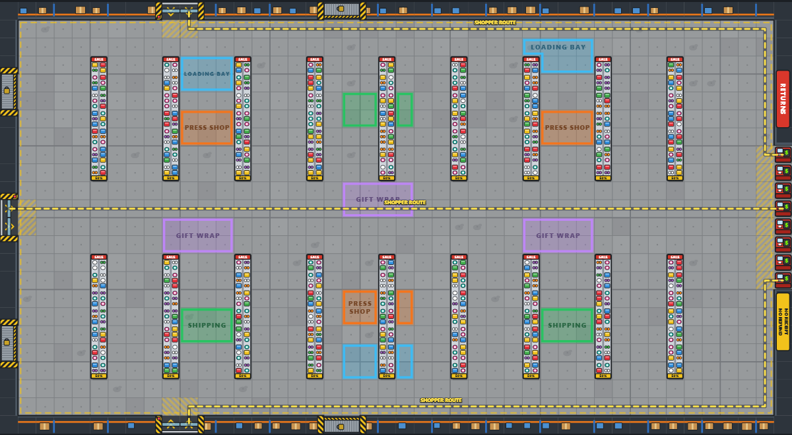

### Food Court
Little tables, sticky booths, kebab stalls and a fountain full of pennies. The crowd weaves through it all; so do your belts.

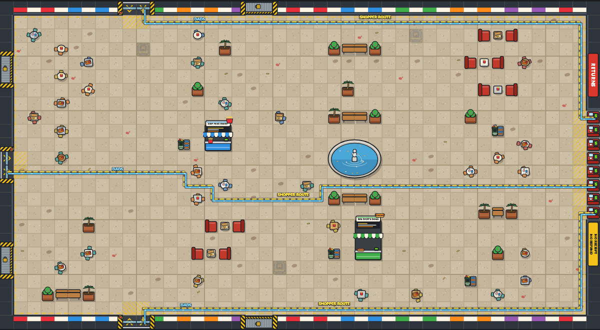

### Car Park
The sale has spilled outside. Rows of parked cars with the odd empty bay to squeeze through, and tills on two walls: make one way in a slog and the whole crowd takes the other.

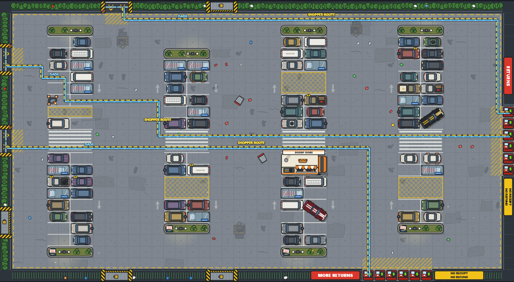

| Size | Tiles | Suits |
|---|---|---|
| Corner Shop | 30 x 16 | the original; cramped |
| Outlet | 36 x 20 | 1 player |
| Superstore | 44 x 24 | 2 players |
| Megastore | 54 x 30 | 3 players |
| Hypermarket | 66 x 37 | 4 players |
| Distribution Centre | 81 x 45 | 5 players |
| Regional Hub | 99 x 55 | 6 players |
| Mega Mall | 121 x 67 | 7 players |
<!-- /gen:maps -->

## The shoppers
<!-- gen:shoppers -->
Patience is what security wears down; when it runs out the shopper storms off and gets no refund. The numbers are for the first sales event at Normal difficulty; patience grows every event. Each picture shows the ordinary shopper and its super version, which turns up later and takes a double refund. The boss, last in the list, walks in with the crowd every 5th sales event.

| | Shopper |
|---|---|
| 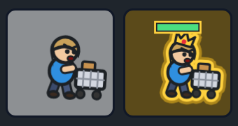 | **Bargain Hunter** · from sales event 1 · patience 36, speed 1.4, refund $20 The ordinary shopper. Stops for free samples and grabs goods off belts. **Beat it with:** Anything. Slow them at a gap and spray them. **Super: Doorbuster** (from sales event 6). Three times the patience, and quicker. |
| 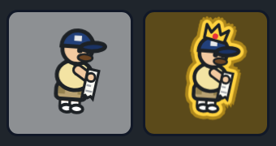 | **Dad** · from sales event 2 · patience 30.6, speed 2.4, refund $50 Arrives in a single-file line, walks fast, ignores samples, and steps over conveyor belts. **Beat it with:** Time: his patience drains by itself. Crates and machines block him. He slips on wet floor signs. Cover his short cut. **Super: Dad on a Mission** (from sales event 7). Two and a half times the patience, faster, never slips, and his patience drains half as fast. |
| 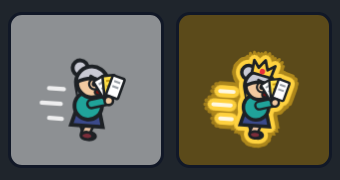 | **Coupon Clipper** · from sales event 3 · patience 14.4, speed 1.9, refund $10 Fast, weak, and there are a lot of them. **Beat it with:** Sprinklers. Anything that hits a crowd. **Super: Extreme Couponer** (from sales event 8). Two and a half times the patience and much faster. |
| 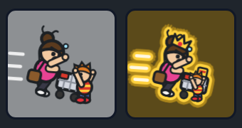 | **Mom and Kid** · from sales event 3 · patience 49.5, speed 1.3, refund $40 Her kid escapes the cart and runs ahead, straight through your belts, machines and crates, then waits further along the route. She sprints round the maze to reach him and ignores free samples on the way. If her patience runs out while he is loose, she does not leave: she crawls to him, nothing can hurt her, and security wastes its shots on her. When she reaches him she gets up with a third of her patience back, without her cart, and carries him from then on. He runs away once only, he never runs all the way to the tills, and she will not take her refund without him. **Beat it with:** Finish her while the kid is in the cart. Forklifts and wet floor signs. Samples only work while the kid is in the cart. A TV Salesman stops most runaway kids. **Super: Soccer Mom** (from sales event 9). Twice the patience. Sprints twice as fast after a kid who runs twice as far, and he can run away twice. She keeps her cart until the second time she goes down. |
| 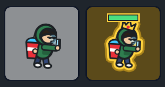 | **Teenager** · from sales event 4 · patience 40.5, speed 1.2, refund $24 Slow. Spills a slushie every few seconds; the mess slows every other shopper and dads slip on it. **Beat it with:** Let him loiter in range. His messes work for you. **Super: Teen Influencer** (from sales event 11). Twice the patience. Three times the mess, and it stays twice as long. |
| 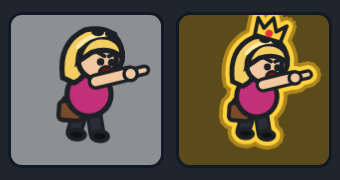 | **Karen** · from sales event 5 · patience 153, speed 0.9, refund $80 Enormous patience. Security near her works at half speed while she asks for the manager. **Beat it with:** Long routes and forklifts out of her reach. Do not rely on one cluster of towers. **Super: Karen Supreme** (from sales event 10). Four times the patience. Slows security twice as far away, to a quarter speed. |
| 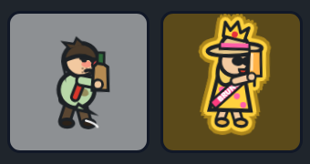 | **Day Drinker** · from sales event 5 · patience 45, speed 1.3, refund $30 Weaves along at a speed that keeps changing. At corners of the route he may fall over and lie there for 4 seconds, and everyone else has to squeeze past him at a third of their speed. **Beat it with:** Corners near your security: when he goes down, the queue behind him stands in the spray. **Super: Bottomless Bruncher** (from sales event 12). Two and a half times the patience. Falls over at half the corners and stays down 6 seconds. |
| 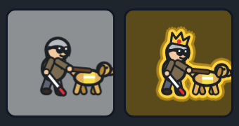 | **Man with Guide Dog** · from sales event 6 · patience 63, speed 1.1, refund $40 The guide dog steers him around puddles and messes, and he cannot see free samples. Pepper spray makes the dog bolt, dragging him along fast. **Beat it with:** Forklifts. Sprinklers make him faster. **Super: Man with Two Guide Dogs** (from sales event 14). Two and a half times the patience. The dogs bolt from forklift hits too, further and faster. |
| 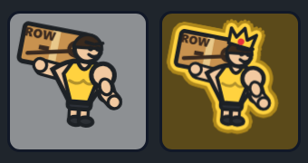 | **Gym Bro** · from sales event 6 · patience 76.5, speed 1.5, refund $60 Walks straight through crate stacks, wrecking any in his way and any he passes, and now and then something else beside him: a belt, a machine, a tower. But he only has two hits in him a visit, and needs 10 seconds to get his breath back after each. While he does, and once he is spent, he walks round crates like anyone else. **Beat it with:** Stop him early, before he reaches anything expensive. Every hit he lands counts, even one a Durability upgrade soaks up (the damage is forgotten every sales event), so a durable crate stack where he first meets your maze takes a hit off him for nothing, and makes him walk the long way round. Press B to rebuild what he wrecked at half price. **Super: Roid Rager** (from sales event 12). Two and a half times the patience, and faster. Three hits instead of two, only 5 seconds apart, and he goes for things that are not crates far more often. |
| 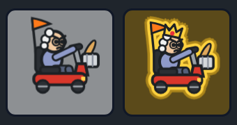 | **Mobility Scooter** · from sales event 7 · patience 85.5, speed 1.2, refund $40 Cannot be slowed by anything. **Beat it with:** Raw damage over a long route. **Super: Turbo Scooter** (from sales event 13). Two and a half times the patience and nearly twice the speed. |
| 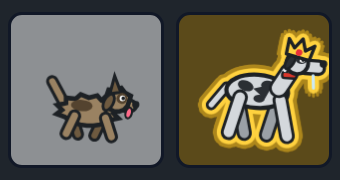 | **Stray Dog** · from sales event 7 · patience 19.8, speed 2.6, refund $10 Fast, with little patience. Pees on any security it passes (not wet floor signs), which switches that building off for 6 seconds. **Beat it with:** Stop it before it reaches your best security. Spread security out so one dog cannot switch off a whole gap. **Super: Great Dane** (from sales event 13). Two and a half times the patience and faster. Switches security off for 12 seconds, from further away, and more often. |
| 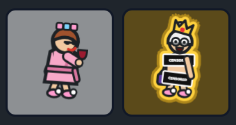 | **Exhibitionist** · from sales event 8 · patience 54, speed 1, refund $30 A woman in a bathrobe who opens it every few seconds. Dads and teenagers within 2.5 tiles stop and stare for 2 seconds. **Beat it with:** She helps you: let her walk with the dad line, in range of something that hurts. **Super: Nudist Nan** (from sales event 14). Two and a half times the patience. No robe at all: stops dads and teenagers within 4 tiles for 3 seconds, every few seconds. |
| 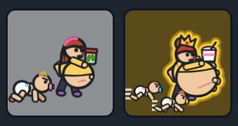 | **Pregnant Lady** · from sales event 8 · patience 117, speed 0.9, refund $60 Very pregnant: slow, with a lot of patience, and she stops for every free sample (she is eating for thirteen). When her patience runs out she does not leave. She pops, and a dozen babies run for the tills from where she stood: very fast, with very little patience, and nothing distracts them. A baby at a till takes $5 but is not a refund toward the limit. If she reaches a till herself she takes one refund and nothing pops. **Beat it with:** Finish her with a Barcode Laser: if its beam takes her last patience, no babies come out. Otherwise wear her down early, so the babies have the whole maze to run, with sprinklers and wet floor signs along it to catch them. **Super: Octomom** (from sales event 14). Two and a half times the patience, and two dozen babies when she pops. A Barcode Laser still stops all of them. |
| 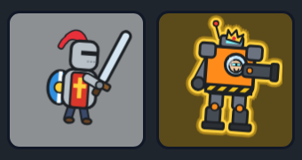 | **Cosplayer** · from sales event 9 · patience 135, speed 1.3, refund $60 A big costume and a lot of patience. Shots from sprinklers, forklifts and barcode lasers that would hit a shopper standing next to him hit him instead. **Beat it with:** Wear him down while he is alone, or separate him from the crowd: free samples and salesmen stop the others while he walks on. **Super: Full Mech Suit** (from sales event 15). Two and a half times the patience. Shields shoppers within 1.6 tiles and takes only half of what he soaks up. |
| 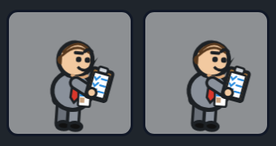 | **Regional Manager** (the boss) · every 5th sales event · patience 288, more for each rank, speed 0.7, refund $150 times his rank Head Office sends a manager to find out why refunds are down. He walks in a little after the doors open, slowly, with enormous patience, and nothing slows or stops him: not wet floors, messes, free samples, a drunk on the floor, the TV Salesman or a naked woman. Every few seconds he gives a pep talk, and every shopper near him gets some patience back. He gets a grander title, and more patience, every time he comes back. Every 7 seconds his pep talk gives every shopper within 3.5 tiles 20% of their patience back. If he reaches a till he counts as 2 refunds; if he storms out the store gets a bounty of $165 times his rank. **Beat him with:** Raw damage along a long route. Get him away from the crowd, so his pep talks have nobody to cheer up, and do not let him reach a till: he counts as several refunds at once and takes a huge one. Drive him out and the store gets a bounty. **Ranks:** Regional Manager (event 5), Area Director (event 10), Vice President of Returns (event 15), The CEO (event 20 on). |
<!-- /gen:shoppers -->

The game's own **Employee Handbook** (the book button, on the menu and in the game) has every shopper (and the boss), machine and piece of security with its full numbers: patience event by event, how many turn up, and what each upgrade level costs and does.

## Play on this computer without the internet
The link above is the easy way. To run your own copy instead (for example to try changes), you need Node.js (any recent version) to serve the files.

Double-click `play.bat`. It starts a small local server and opens the game in your browser. Keep its window open while you play; closing it stops the server, and the page will then say "Unable to connect".

Or by hand: run `node tools/serve.mjs`, then open http://localhost:5173/ in Chrome, Edge or Firefox.

- **Training shift** teaches every building hands on in about ten minutes, then every awkward kind of shopper in about ten more ("Jump to part 2" skips straight to those). Start here.
- **Painted floor:** Unpackers, Presses, Packers and Shipping Chutes each only go on their own named patch of floor (Loading Bay, Press Shop, Gift Wrap, Shipping). The patches are apart, so belts carry the goods between them, and those belts are your maze.
- **The store** on the menu picks the map for Play solo and Host a game: a design (open warehouse, showroom of walled rooms, supermarket aisles, food court, car park) and a size. Each size says how many players it suits; every player gets his own shopper entrance.
- **The game** on the menu sets its length (10, 15, 20 or 30 sales events, or **Endless**), the difficulty and each player's starting cash. An endless game has no last sales event: it goes on until the refunds close the store, and the browser remembers the furthest sales event reached on each difficulty. A game that has been won can also be carried on as an endless one with **Keep going (endless)** on the win screen.
- **The boss** walks in every fifth sales event, a little after the doors open: slow, very patient, and nothing slows or stops him. His pep talks give the shoppers around him patience back. If he reaches a till he counts as two refunds; drive him out and the store gets a bounty. He comes back with a grander title each time (Regional Manager, Area Director, Vice President of Returns, The CEO). A bar across the top of the floor shows his patience while he is in the store.
- **The Car Park** is the one store with tills on two walls: the usual bank on the right and a second in the bottom wall. Shoppers walk to whichever is nearer, so lengthening one route sends the crowd to the other. Both banks must stay reachable: a building that would wall one off is refused. Its entrances in the bottom wall open last (for a sixth and seventh player), because they are close to the bottom tills.
- **Play solo** starts a real game straight away.
- The speaker button at the top right turns sound effects, music and DEB's voice on or off.
- To try multiplayer alone, open http://localhost:5173/tools/two-player.html : a host and a second player side by side.

## Play online with friends
The game is online multiplayer for up to seven players, wherever they are. Nobody runs a server: one player hosts in his browser and the others connect to him directly over the internet.

1. Everyone opens https://bobbfwed.github.io/No-Receipt-No-Mercy/ . (The site is this repository published with GitHub Pages from the `main` branch; every push to `main` updates it within a minute or two.)
2. The host enters a name and presses **Host a game**. A five-letter room code appears at the top.
3. The host presses **Copy link** and sends it to his friends (or reads them the code). They open the link, enter a name and press **Join a game**.
4. Everyone lands in the lobby, with the store drawn whole on the right. The host can change its design and size there, and the game's settings (how many sales events or endless, the difficulty, and each player's starting cash), and everyone sees it change. The same settings can be chosen on the menu before hosting. Each player presses **READY**; the game starts when all of them have.
5. Friends can also join after the game has started, even mid-wave, and play at once. If someone drops out he can rejoin with the same name and gets his place back.
6. A player whose connection drops keeps his money for 90 seconds (real time, whatever the game speed); if he is back by then nothing is lost, and if not it is shared between the others. If the host leaves, the game carries on: another player's browser takes over as host within a few seconds (up to a minute), and everyone else reconnects by themselves. The player who left can come back with the same link and gets his place back. Only when the last player leaves is the game gone.
7. Once a game is under way, the browser asks before the page is closed, refreshed or left, so a stray Back button does not end it.

**Known limit: two players on the same network.** A player on the same wifi or home network as the host usually cannot join (tested: a phone joining a computer on one network fails, and the same phone on mobile data succeeds). Two browsers on one network can only reach each other through a relay server, and the game does not have a dependable one yet. Until it does, a player in the same house as the host should join over mobile data, or play from a different network. (For whoever runs the site: the fix is a relay account, whose details go in `src/net/relay.js`; the instructions are in that file.) The same message, "could not reach each other", can also mean a strict firewall or VPN. https://bobbfwed.github.io/No-Receipt-No-Mercy/tools/net-check.html shows what a given device's network allows.

The first connection goes through the free public PeerJS service, which only introduces the browsers to each other; the game data then travels directly between you. If that service is down, online games cannot start (solo still works).

## Head Office: one of you plays the shoppers
With two or more players, one can stop defending and run the other side. Between sales events, press **Run the shoppers** next to your name in the players list. Each build phase you then get a budget and buy the coming crowd: which kinds of shopper, how many, which entrance each group uses and when it arrives. Buy nothing and the usual crowd comes. You win if the store reaches its refund limit; the others win if it survives every sales event (in an endless game, the store can only lose). The boss comes in every fifth sales event whatever you buy, free of charge; you cannot buy him. Somebody must always be left running the store.

## Controls
| Key or mouse | Does |
|---|---|
| 1 to 9, 0, - and = | Pick a building (or click it in the bar). - is the Barcode Laser, = the TV Salesman |
| Click | Build |
| Drag | Build a line; belts follow the drag |
| R | Rotate what you are holding, or the building under the mouse when holding nothing. The Barcode Laser fires the way it faces, so turn it before you place it |
| Click a building with nothing picked | Opens its upgrades. Each kind (damage, speed, range, durability) is bought on its own; each level costs more than the last |
| U | Buy the next level of the first upgrade of the building under the mouse (or pick the Upgrade tool and click a building to open its upgrades) |
| B | Rebuild everything of yours that gym bros have wrecked, at half price, upgrades included |
| Right-click, or X then click | Remove (75% of what was spent on it back) |
| OPEN THE DOORS | Start the next sales event without waiting for the timer. It costs nothing: the factory is paid at once for what it would have sold in the time skipped |
| Esc | Put the tool down |
| W A S D, or arrow keys | Move the view around the map |
| Mouse wheel | Zoom. Middle-button drag also moves the view |
| F | Show the whole map |
| H | Go to your own entrance |
| Click the small map | Jump there (it appears when the store does not fit on screen) |
| Give $50 / $200 / $1,000 (players list) | Hand a colleague some of your cash |

## Carrying a game on another day
The host's browser saves the game by itself every few seconds while it is under way. Next time the host opens the game on the same device and browser, the menu offers **Resume saved game**, showing the sales event, the store, who was playing and when it was saved. Resuming makes him the host again. If others were in the game, a new room code appears: he sends it to them, and each gets his place and his money back by joining under the same name. There is one save per browser; a finished game clears it (a won game carried on as an endless one is saved again), and **Delete this save** throws it away. It is not saved online, so it cannot be resumed from a different device.

## On a phone or tablet
The game works by touch, in either orientation (a tablet, or a phone held sideways, is more comfortable).

| Touch | Does |
|---|---|
| Tap a button in the bar | Pick that building or tool; tap it again to put it down. Hold a button to read what it does |
| Tap the floor with a building picked | Build |
| Drag with a building picked | Build a line; belts follow your finger |
| Drag with nothing picked | Move the view |
| Two fingers | Move the view and pinch to zoom, whatever is picked |
| Tap a building with nothing picked | Opens its actions: a button for each kind of upgrade, rotate, remove |
| Buttons at the end of the bar | Rotate, and put the tool down |
| MAP and HOME on the floor | Show the whole store; go to your entrance |
| The menu button at the top right | Speed, room code and link, sound, help |

The tutorial and the help text word their instructions for touch when the game is opened on a touch screen.

**Full screen.** The button at the top right (⛶, inside the menu button on a phone) switches full screen on and off on Android and on computers. To get an app icon that opens the game full screen:
- Android (Chrome): open the game, tap the browser's menu (three dots), then **Install app** or **Add to Home screen**.
- iPhone and iPad (Safari): tap the Share button, then **Add to Home Screen**. iPhones do not allow the full-screen button, so this is the only way there.
- Computer (Chrome or Edge): the install icon at the right of the address bar.

## Chat
With more than one player in the game, press Enter (or the Chat button) to type a line to everyone. It works in the lobby too.

## For developers
- `node --test` runs the tests.
- `PLAN.md` has the plan and the decisions taken so far.
- `docs/architecture.md` explains how the code is organised and the testing tools.
- `CLAUDE.md` has the project rules for AI assistants.

## License
Copyright 2026 Brandon Nimon. The game is licensed under the [PolyForm Noncommercial License 1.0.0](LICENSE.md), in every version and every commit of this repository. Anyone may play it, change it, share it and build on it for any noncommercial purpose. Nobody may sell it or use it commercially. Anyone who passes on any part of it must include the license and its "Required Notice" line, which credits the original author. `vendor/peerjs.min.js` is PeerJS, under its own MIT licence (see [LICENSE.md](LICENSE.md)).
